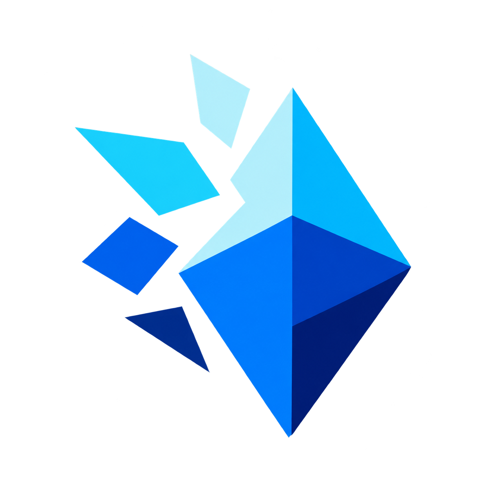

# knowledge-refinery



Codex や Claude Code で得た開発経験を、複数のプロジェクトから再利用できる形で残すためのPluginです。
試行や失敗をexperienceとして記録し、そこから抽出した原則をmemoryとして、プロダクトrepoとは
別のローカル中央vaultへ保存します。

## はじめる

Python 3.11 以上と `uv` を用意します。初期設定に使う CLI はプラグインに同梱されています。

### Claude Code

```bash
claude plugin marketplace add skanehira1126/knowledge-refinery
claude plugin install knowledge-refinery@knowledge-refinery
```

### Codex / ChatGPT desktop app

```bash
codex plugin marketplace add skanehira1126/knowledge-refinery
```

マーケットプレイスを追加したら、Codex のプラグイン画面で `knowledge-refinery` をインストールします。

### vault と利用先リポジトリの設定

利用したいリポジトリで新しいセッションを開きます。Codex では `$refinery-project`、
Claude Code では `/knowledge-refinery:refinery-project` を選んで、次のように依頼してください。

> このリポジトリで Knowledge Refinery を使えるように設定してください。

ナレッジの保存先（vault）とプロジェクト ID を確認すると、スキルが必要に応じて vault を作成し、リポジトリを登録して動作を確認します。
Codex では `/hooks`（デスクトップでは `Settings → Hooks`）で、使う hook を確認して信頼してください。

登録後は新しいセッションで普段どおり開発を依頼できます。エージェントは過去の経験が役立つときに検索し、再利用できる試行や失敗を記録します。検索・診断・提案のみの依頼は読み取りで完了します。

[端末用 CLI と手動セットアップ](docs/getting-started.md)・[Codex プラグインの更新](docs/development.md#plugin更新の確認)

## 主な機能

- 成功、失敗、不採用案をexperienceとして記録し、既存の原則が判断に影響したときは採用・見送りの理由と観測結果も残す
- experienceから再利用可能なproject memoryとshared memoryを抽出する
- 現在のrepoから、必要に応じて他repoのknowledgeまで検索する。MCPの検索語は `terms` の配列で指定し、未知の引数はエラーとして返す。[MCPの検索引数](docs/mcp.md)
- `refinery_archive_memory`で原則を通常検索から外し、旧IDに本文・理由・任意の後継参照を残す。履歴を含めるには`refinery_search_memory`の`include_archived`を指定する。[運用ルール](docs/knowledge-operations.md#memory-lifecycle)
- 入力時、対象ツールの実行前後、サブエージェント開始時に、その場面用に保存したprojectの前提をMCPから渡す。[配信先一覧](docs/cli.md#context)
- 任意でCodexを使い、中央vaultの検証済みsnapshotから根拠付きの深い検索を行う
- repoごとに利用を無効化・再有効化する
- 中央vaultを独立したGit repositoryとして履歴管理する
- 中央vaultを直接開き、project登録なしで横断検索・棚卸し・承認済みの知識更新を行う
- 特定の作業の状態をhandoffに保存し、新しいチャットで再評価して再開する
- `refinery-issue` SkillやCLIで独立したissueを管理し、複数projectの紐付け、進捗・タグ・更新履歴を追跡する

登録済みで有効なprojectでは、hookで渡す前提の管理を既定でエージェントに任せます。
たとえば作業中に注文スキーマの管理元が変わったと確認できたら、エージェントが
`refinery_get_context` で現在の本文を読み、`refinery_update_context` で該当する配信先だけを更新します。
配信先は `refinery_list_contexts` で確認できます。該当イベントではCodex・Claude Codeが接続済みMCPの
`refinery_deliver_context` を直接呼びます。固定のSessionStart hookはrepoの有効設定を確認し、CLIパッケージ同梱の指示を返します。
[refinery-curate-context](docs/skills/refinery-curate-context.md)・[contextのMCP操作](docs/mcp.md#hook-context)

## 課題を管理する

「Knowledge Refineryにこの課題を記録して」「project exampleの進行中issueを一覧して」のように
目的を伝えるか、`$refinery-issue`を指定して依頼できます。issueはactive vault単位で管理し、
project未所属・複数projectへの紐付けに対応します。repo登録や有効化は不要です。
エージェントは `refinery_list_issues` でproject ID・状態・タグを絞り、
`refinery_get_issue` で本文・完了条件・履歴・revisionを取得します。作成と更新にはCLIを使います。
作成・更新は依頼された範囲で行い、ナレッジの自動記録からissueを自動生成しません。
使い方は[refinery-issue](docs/skills/refinery-issue.md)と[CLIリファレンス](docs/cli.md#issue)を参照してください。

## vaultを直接開いて保守する

中央vaultを開いたチャットで`$refinery-maintenance`に棚卸しや修復を依頼できます。
`knowledge-refinery vault status --target "$REFINERY_VAULT" --json`、またはMCPの
`refinery_vault_status(vault_path)`でactive vaultとの一致を確認します。MCPの検索・更新には
返された`vault_context`と`project_path: null`を渡します。vault自身のproject登録は不要です。

この入口は中央の保存資料を管理し、各repoのopt-outは変更しません。無効repoからの自動迂回には
使いません。shared memoryの新規作成・昇格とknowledgeの削除には具体的な対象への明示承認が必要です。
対象の指定とAPI例は[MCP tools](docs/mcp.md#vault-maintenance)、手順は
[refinery-maintenance](docs/skills/refinery-maintenance.md)を参照してください。

## 新しいチャットへ引き継ぐ

`$refinery-handoff`は明示呼び出し専用です。旧チャットで
「`$refinery-handoff`を使って、この作業の引き継ぎを保存してください」と依頼すると、
目的・完了条件・現在の成果物・確認済みの事実・未解決事項を保存し、引き継ぎIDと再開用の依頼文を返します。
新しいチャットでは、保存元の`project_id`と引き継ぎIDを指定して同Skillに再開を依頼します。
参照には保存元repoのローカルパスは不要です。MCPの`refinery_get_handoff(project_id, handoff_id)`で
取得でき、`refinery_list_handoffs(project_id=...)`でprojectを絞るか、省略してactive vaultの全projectを
一覧できます。CLIも`handoff get <ID> --project-id <project-id>`と`handoff list`に対応します。

handoffはprojectごとの専用領域に保存され、通常のexperience／memory検索には
含まれません。読み込みでは消費せず、新版への置き換えや明示された終了でアーカイブします。
自動期限・自動削除はなく、削除は指定したアーカイブ済みの資料だけを対象にします。
作成・再開・整理の手順とCLI例は[引き継ぎガイド](docs/handoffs.md)を参照してください。

機能の使い分け、保存前の確認境界、データ構造は
[Web版ドキュメント](https://skanehira1126.github.io/knowledge-refinery/)で説明しています。

## 詳細情報

- [導入とオプション](docs/getting-started.md)
- [エージェントへの頼み方](docs/agent-workflow.md)
- [利用repoのAGENTS.md追記サンプル](docs/agents-guidance-examples.md)
- [ナレッジモデルと検索](docs/knowledge-model.md)
- [repoの有効・無効](docs/project-lifecycle.md)
- [ナレッジ運用](docs/knowledge-operations.md)
- [CLIリファレンス](docs/cli.md)
- [MCP tools](docs/mcp.md)
- [仕組みとデータ配置](docs/architecture.md)
- [トラブルシューティング](docs/troubleshooting.md)

開発時の検証は`bash scripts/validate.sh`でまとめて実行できます。

## セッション解析と改善提案

終了済みの Codex チャットの振り返りには[refinery-review-session](docs/skills/refinery-review-session.md)、
レポートから改善案を比較するには[refinery-propose-improvements](docs/skills/refinery-propose-improvements.md)を
明示して呼び出します。成果物はローカルのMarkdownで、vaultへ自動保存しません。

候補一覧は現在の登録済みGitプロジェクトとworktreeに絞ります。
期間内に実際に作業したチャットは `session list --active-since … --active-before … --include-archived` で探せます。
圧縮ログと同じチャットの継続ファイルも直接抽出できます。
CLIを直接使う場合は[sessionコマンド](docs/cli.md#session)を参照してください。
