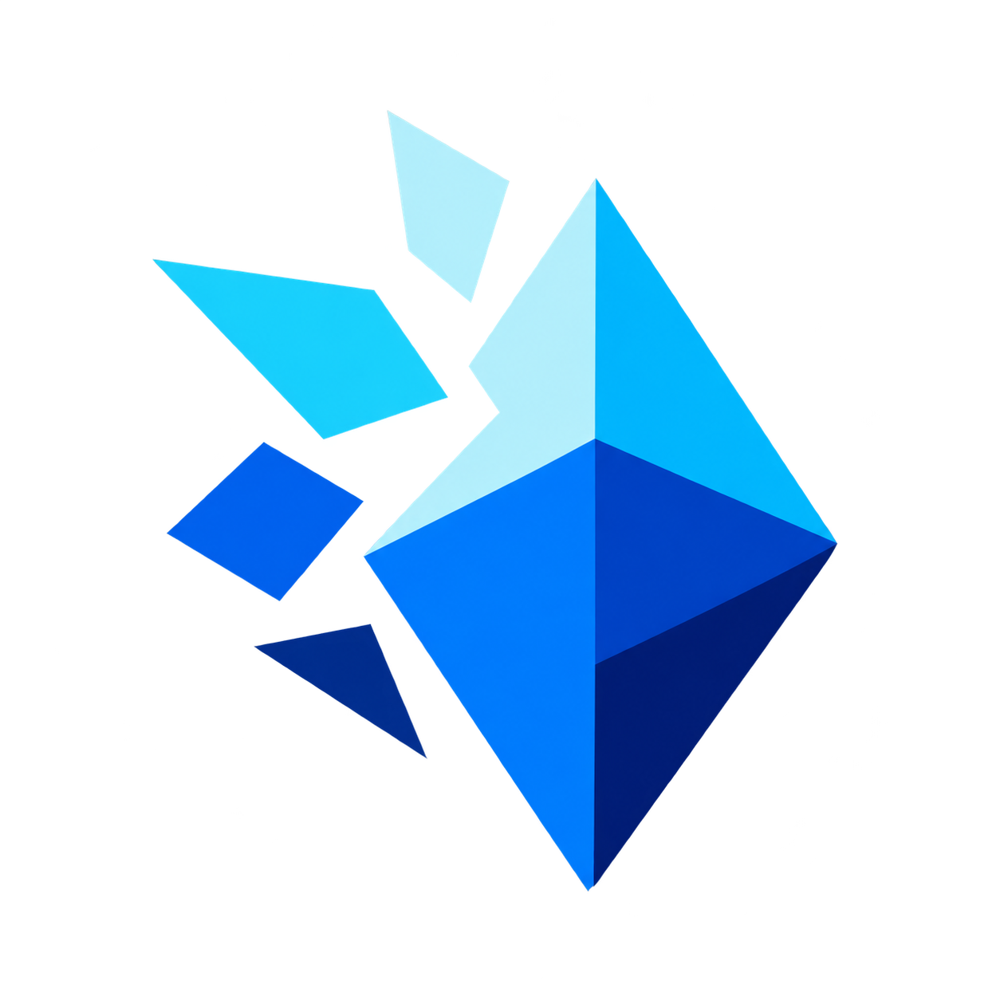

# knowledge-refinery



Codexで得た開発経験を、複数のプロジェクトから再利用できる形で残すためのPluginです。
試行や失敗をexperienceとして記録し、そこから抽出した原則をmemoryとして、プロダクトrepoとは
別のローカル中央vaultへ保存します。

## はじめる

必要なものは、CodexまたはChatGPT desktop app、Python 3.11以上、`uv`です。

まずPluginとCLIをインストールします。

```bash
codex plugin marketplace add skanehira1126/knowledge-refinery
uv tool install git+https://github.com/skanehira1126/knowledge-refinery.git
```

CodexのPlugin画面で`knowledge-refinery`をインストールし、新しいtask/sessionを開きます。

すでにインストール済みのPluginとCLIを更新する場合は、次を実行します。

```bash
codex plugin marketplace upgrade knowledge-refinery
uv tool upgrade knowledge-refinery
```

CodexのPlugin画面で`knowledge-refinery`を再インストールし、新しいtask/sessionを開きます。

次に、knowledgeの保存先となる中央vaultを一度だけ作ります。

```bash
REFINERY_VAULT="${HOME}/knowledge-refinery-vault"
knowledge-refinery vault init --root "$REFINERY_VAULT"
```

Knowledge Refineryを使いたいrepoで、次を実行します。

```bash
REFINERY_VAULT="${HOME}/knowledge-refinery-vault"
PROJECT_ROOT="$(git rev-parse --show-toplevel)"

knowledge-refinery project setup \
  --target "$PROJECT_ROOT" \
  --vault "$REFINERY_VAULT" \
  --agents

knowledge-refinery doctor --target "$PROJECT_ROOT"
```

project IDと表示名はrepoのdirectory名から自動設定されます。`--agents`は、通常の開発taskでも
Knowledge Refineryを利用するための管理対象ルールをrepoの`AGENTS.md`へ追加します。
`doctor`に`ok: yes`と表示されたら準備完了です。

新しいtaskを開き、いつもどおり開発を依頼してください。設計判断・原因調査・手法比較など、
過去の知識が役立つ場面で検索し、単純なtypo・書式変更では省略します。再利用できる試行や
有用な失敗は、毎回の確認質問を挟まずexperienceとして保存し、保存結果まで確認します。
検索・診断・提案のみの依頼では書き込みません。

## 主な機能

- 成功、失敗、不採用案をexperienceとして記録する
- experienceから再利用可能なproject memoryとshared memoryを抽出する
- 現在のrepoから、必要に応じて他repoのknowledgeまで検索する
- 新規チャットの開始時と履歴圧縮後に、vaultの短い[プロジェクトコンテキスト](docs/cli.md#context)をCodexへ渡す
- 任意でCodexを使い、中央vaultの検証済みsnapshotから根拠付きの深い検索を行う
- repoごとに利用を無効化・再有効化する
- 中央vaultを独立したGit repositoryとして履歴管理する
- 中央vaultを直接開き、project登録なしで横断検索・棚卸し・承認済みの知識更新を行う
- 特定の作業の状態をhandoffに保存し、新しいチャットで再評価して再開する
- `refinery-issue` SkillやCLIで独立したissueを管理し、複数projectの紐付け、進捗・タグ・更新履歴を追跡する

初期コンテキストを整えるときは「`$refinery-curate-context` を使って、このprojectの既存ナレッジから
分析の前提を数行に絞り、`context.md` に反映してください」と依頼します。候補だけの提案にも対応します。
使い方は [refinery-curate-context](docs/skills/refinery-curate-context.md) を参照してください。

## 課題を管理する

「Knowledge Refineryにこの課題を記録して」「project exampleの進行中issueを一覧して」のように
目的を伝えるか、`$refinery-issue`を指定して依頼できます。issueはactive vault単位で管理し、
project未所属・複数projectへの紐付けに対応します。repo登録や有効化は不要です。
作成・更新は依頼された範囲で行い、ナレッジの自動記録からissueを自動生成しません。
使い方は[refinery-issue](docs/skills/refinery-issue.md)と[CLIリファレンス](docs/cli.md#issue)を参照してください。

## vaultを直接開いて保守する

中央vaultを開いたチャットで`$refinery-maintenance`に棚卸しや修復を依頼できます。
`knowledge-refinery vault status --target "$REFINERY_VAULT" --json`、またはMCPの
`refinery_vault_status(vault_path)`でactive vaultとの一致を確認します。MCPの検索・更新には
返された`vault_context`と`project_path: null`を渡します。vault自身のproject登録は不要です。

この入口は中央の保存資料を管理し、各repoのopt-outは変更しません。無効repoからの自動迂回には
使わず、shared memory昇格・重要改訂・削除の承認条件も維持します。
対象の指定とAPI例は[MCP tools](docs/mcp.md#vault-maintenance)、手順は
[refinery-maintenance](docs/skills/refinery-maintenance.md)を参照してください。

## 新しいチャットへ引き継ぐ

`$refinery-handoff`は明示呼び出し専用です。旧チャットで
「`$refinery-handoff`を使って、この作業の引き継ぎを保存してください」と依頼すると、
目的・完了条件・現在の成果物・確認済みの事実・未解決事項を保存し、引き継ぎIDと再開用の依頼文を返します。
新しいチャットでは、保存元の`project_id`と引き継ぎIDを指定して同Skillに再開を依頼します。
参照には保存元repoのローカルパスは不要です。MCPの`refinery_get_handoff(project_id, handoff_id)`で
取得でき、`refinery_list_handoffs(project_id=...)`でprojectを絞るか、省略してactive vaultの全projectを
一覧できます。CLIも`handoff get <ID> --project-id <project-id>`と`handoff list`に対応します。

handoffはprojectごとの専用領域に保存され、通常のexperience／memory検索には
含まれません。読み込みでは消費せず、新版への置き換えや明示された終了でアーカイブします。
自動期限・自動削除はなく、削除は指定したアーカイブ済みの資料だけを対象にします。
作成・再開・整理の手順とCLI例は[引き継ぎガイド](docs/handoffs.md)を参照してください。

機能の使い分け、保存前の確認境界、データ構造は
[Web版ドキュメント](https://skanehira1126.github.io/knowledge-refinery/)で説明しています。

## 詳細情報

- [導入とオプション](docs/getting-started.md)
- [エージェントへの頼み方](docs/agent-workflow.md)
- [利用repoのAGENTS.md追記サンプル](docs/agents-guidance-examples.md)
- [ナレッジモデルと検索](docs/knowledge-model.md)
- [repoの有効・無効](docs/project-lifecycle.md)
- [ナレッジ運用](docs/knowledge-operations.md)
- [CLIリファレンス](docs/cli.md)
- [MCP tools](docs/mcp.md)
- [仕組みとデータ配置](docs/architecture.md)
- [トラブルシューティング](docs/troubleshooting.md)

開発時の検証は`bash scripts/validate.sh`でまとめて実行できます。

## セッション解析と改善提案

終了済みチャットの振り返りには[refinery-review-session](docs/skills/refinery-review-session.md)、
レポートから改善案を比較するには[refinery-propose-improvements](docs/skills/refinery-propose-improvements.md)を
明示して呼び出します。成果物はローカルのMarkdownで、vaultへ自動保存しません。

CLIを直接使う場合は[sessionコマンド](docs/cli.md#session)を参照してください。
