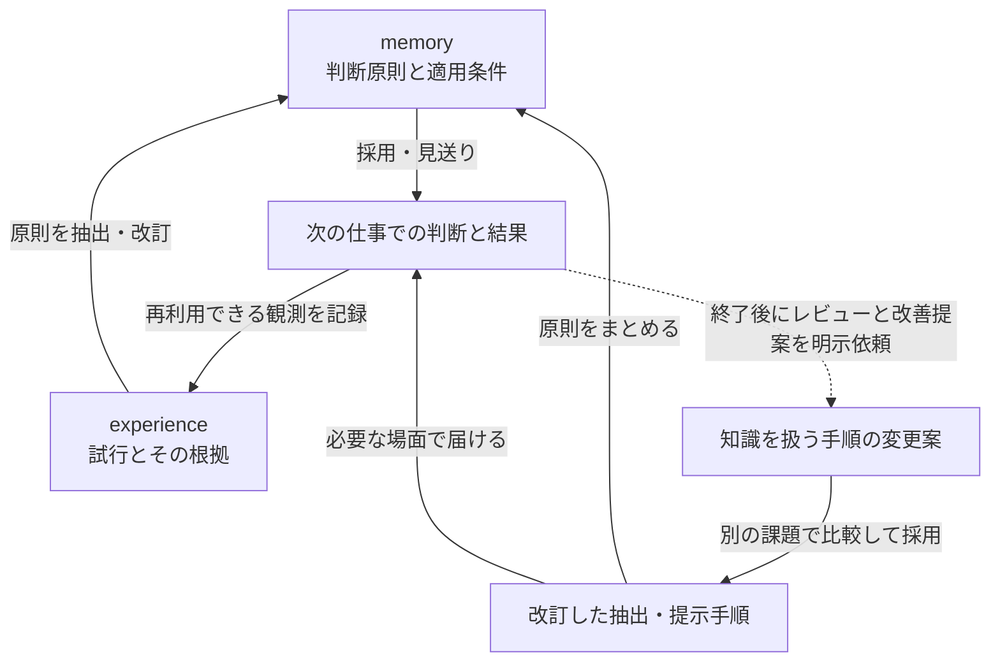

# Knowledge Refinery の自己改善をどう設計するか

提案は、**仕事の結果から、判断原則と、その原則を作って次の仕事に届ける手順の両方を更新できる設計**にすることだ。改善の判定は、同じモデルを使う次のセッションが、更新した知識や手順を引き継ぐことで別の課題をよりよく解けるかに置く。

v0.7.5 の設計図には、すでに「利用結果・反例・新しい条件」を次の `experience` へ戻す矢印がある。終了したセッションの実行結果から作業手順の改善を提案する機能もある。補いたいのは、**どの原則がどの判断に影響し、その結果から知識と手順のどちらを見直したか**を、後からたどれることだ。以下は2026年11月22日時点の公開資料と現行版（`4bb5436`）を照合した設計提案である。[現行のナレッジモデル](knowledge-model.md)・[セッションレビュー](skills/refinery-review-session.md)・[改善提案](skills/refinery-propose-improvements.md)

## 一つの経験から、何を更新するか

例えば、ある原則を使った作業がテストで差し戻されたとする。本文にも例外条件が抜けていたなら、その原則を改訂する根拠になる。本文には例外が明記されていて、複数の作業で要約から同じ条件が抜け落ちていたなら、見直す対象は要約を作る手順だ。この二つでは、修正先も「直った」と判断する方法も違う。

この構造には二つの先例がある。KCS は、日々の問題解決で記事を育てる Solve Loop と、複数の解決事例から仕事の進め方を改める Evolve Loop を結んでいる。Meta Context Engineering は、エージェントに渡す文脈と、それを生成する手順の両方を改善対象にし、手順の実行履歴と評価から次の候補を作る。Refinery でも、同じ観測を二つの改善に使える。変更を決める場所は、各成果物を管理する場所に合わせられる。[KCS v6 の実践ガイド](https://library.serviceinnovation.org/KCS/KCS_v6/KCS_v6_Practices_Guide/030)・[Meta Context Engineering（ICML 2026）](https://proceedings.mlr.press/v306/ye26g.html)・[現行の責任分界](architecture.md)

## 二つの改善をつなぐのは「どの判断が変わったか」

`source_experiences` は「この memory を作る根拠になった試行」を表す。後の仕事で原則を読んだ事実、その原則を採った理由、採った結果は、それぞれ別の情報である。現行の `related_experiences` と `supersedes` は同じ project の experience 同士を結ぶ。利用した memory と結果の関係は、現在も experience 本文に書けるが、両者を結ぶ専用の検索条件はない。[YAML schema](schema.md)・[MCP の検索条件](mcp.md)

**最初の取り込みは、普段の記録でこの関係を読めるようにすること。** 過去の原則を使う、あるいは条件が合わずに見送ることで将来の選択が変わり得る場合、既存の experience の「試したこと」「分かったこと」に、参照した memory の scope・ID、当時の要点、実際に選んだ行動、後から確認できた結果を短くつなぐ。改訂の前後で意味が変わる場合は読んだ時点の `updated_at` を添える。何が効いたか切り分けられなければ、観測できた結果と残る仮説をそのまま書ける。[experience の記録基準](skills/refinery-experience.md)・[revision 付き更新の仕様](schema.md)

この方法を一時 vault で確かめた。同じ memory の ID を本文に含め、片方に「採用した」、もう一方に「条件が合わず見送った」と記した人工の experience は、現行の全文検索で両方とも見つかった。memory 側では成立時の根拠2件が保たれた。検索件数は2件、本文上の採用は1件である。この差は、利用回数や検索ヒットをそのまま「役に立った回数」と数えると失われる。

使った知識だけを振り返ると、必要だったのに届かなかった知識が調査から漏れる。終了後のレビューで有用な原則を初めて見つけた場合は、「作業中に採用した原則」と「後から照合した候補」を区別する。当時の記録から読んだか分からない場合は、利用の有無を未確認として扱う。これは現行のセッションレビューが Skill の本文取得と適用を区別している考え方を、memory にも広げる提案だ。[セッションレビューの記録項目](session-analysis.md)・[レビューの用途](skills/refinery-review-session.md)

判断が改善したかを見るには、出力のテスト、仕様との照合、利用者による訂正など、その判断を覆し得る結果が要る。`confidence` は記録の根拠の強さ、project / shared は成立する範囲を示す。どちらも、ある仕事でその知識を見せる価値とは別に扱いたい。自己採点を繰り返す記憶システムでは、誤った経験に高い点がつき、その後の再利用でも誤りが強まる現象が報告されている。[現行の confidence の定義](knowledge-model.md#status-confidence)・[Memory Reward Inflation in Self-Improving LLM Agents](https://arxiv.org/abs/2608.00017)

### 現役の原則を検索に残す

この検討から、配布Skillの記録手順には、判断に使ったmemoryとその結果を同じexperienceへ残す方法を取り込んだ。memoryの管理では、部分的な反例は同じIDの適用条件に反映し、全範囲を後継が引き継ぐ場合や前提が失われた場合はアーカイブを提案する。通常検索には現役の原則が残り、古いIDを読むと当時の本文、取り下げの理由、任意の後継を確認できる。[記録・改訂・アーカイブの運用](knowledge-operations.md#memory-lifecycle)・[検索と後継参照の仕様](schema.md#memory-archive)

## 知ったことを、どこで働かせるか

判断原則として読むのが適した知識も、作業時に実行できる形へ移す方が役立つ知識もある。選ぶ基準は、**次の仕事のどの場面で、誰が何を変えられるか**だ。

- **条件によって判断が変わる知識**は、条件・反例とともに検索できる memory に置く。作業開始時に欠けると広く誤解を招く安定したドメイン知識は、対象 project の `SessionStart/startup` で配信する候補になる。shared memory への昇格には、独立した2 project 以上の根拠と具体案への利用者の承認が要る。原則や適用範囲の改訂も、差分と根拠を示して判断する。[memory の改訂・昇格条件](skills/refinery-memory.md)・[hookコンテキストの用途](skills/refinery-curate-context.md)
- **繰り返す手順や機械的に判定できる条件**は、手順を持つ Skill、判定を担うテストや CLI へ反映する候補になる。Every の Compound Engineering は、解決後に何を残すと再発を防げるかを、解決記録・規約・テストなどから選ぶ。Hermes Agent は経験から Skill を作り、利用中に更新する実装例で、保守対象もその Skill の由来で区別する。Refinery では、vault に残した根拠から、その手順を所有する repo へ変更案を渡せる。[Every の設計](https://everyinc.github.io/compound-engineering-plugin/guides/ce-compound/)・[Hermes Agent](https://github.com/NousResearch/hermes-agent)・[Hermes の Skill 保守](https://hermes-agent.nousresearch.com/docs/user-guide/features/curator)
- **手順に取り込んだ知識**は、その後も見直せる必要がある。OpenClaw 向けの self-improving-agent は、指示に反映した教訓と元記録を対応づけ、再審査だけで再発回数を増やさない。Refinery でも、提案に元の観測を、検証に採用した差分を対応づけておくと、次の失敗から改訂すべき箇所へ戻れる。配布 Skill の改訂は開発 repo の差分として扱い、中央 vault とプロダクトの Git 履歴はそれぞれの管理者が扱う。[self-improving-agent の運用](https://github.com/pskoett/self-improving-agent/blob/master/self-improving-agent/SKILL.md)・[Git の責任分界](git-operations.md)

## 改善を採用する根拠を、次の仕事で得る

たとえばセッションレビューで、複数の原則の要約から、判断を左右する条件が繰り返し落ちていたと確認できたとする。改善案は「要約には結論と、その結論が反転する条件を一緒に残す」となる。この仮説は、元の記録をきれいに書き直せたかだけでは評価しにくい。次の順で効果を切り分けられる。

1. **現行の手順と候補を、同じ過去資料に適用する。** 原則の抽出手順を比べるなら検索条件は揃える。検索や提示方法を比べるなら同じ memory 群を使う。候補作りに使ったセッションと評価課題を分け、改善案を思いつくきっかけになった事例への過剰な適合を避ける。
2. **新しいセッションで、後続の課題を解く。** 同じモデル・ツール・予算で、記憶なし、現行手順、変更候補を比較する。有用な記録が分かっている課題では、その ID を直接渡す条件も加える。直接渡すと解けるのに通常検索で失敗するなら、次に調べるのは検索結果への到達と、提示後の使われ方だ。
3. **改善と後退を、課題ごとに見る。** 旧手順で誤った判断を救えた件数と、以前できた判断を新たに誤らせた件数を両方残す。条件が逆転する事例や関連知識がない仕事も含め、作業時の手数と、知識を作り直す費用を合わせて比べる。効果が特定 project に限られれば適用先を絞り、後退が勝れば以前の手順を選べる。

Agent Plasticity はモデルを固定し、前の実行で作った成果物だけを新しい文脈へ引き継ぎ、学習に使わなかった課題で能力の変化とコストを追った。ゲーム環境での結果であり、ここで借りるのは比較方法だ。開発課題の VibeMemBench では、有用な経験を直接渡すと改善する課題を選んでも、通常の記憶システムと解決エージェントの12の組み合わせのうち11で、解決率は記憶なしを上回らなかった。MemDev-Bench も、関連する履歴の誤用で以前解けた課題が失敗する場合を報告している。[Agent Plasticity](https://arxiv.org/html/2610.08902v1)・[VibeMemBench](https://arxiv.org/html/2609.23570v1)・[MemDev-Bench](https://arxiv.org/html/2610.27524v1)

## 記録と検索の知見を全体設計に当てはめる

| 公開資料の知見 | Knowledge Refinery での位置づけ |
| --- | --- |
| ReasoningBank は成功・失敗の両方から再利用できる戦略を抽出する。[論文](https://arxiv.org/abs/2509.25140) | 失敗を含む experience は、次回どの条件で手段を選び、どこで見切るかを学ぶ材料になる。 |
| GitHub Copilot Memory は原則を使うときに現行ブランチの出典を確かめる。Karpathy の LLM Wiki は資料が変わったときに影響する主張や矛盾を見直す。[GitHub の設計](https://github.blog/ai-and-ml/github-copilot/building-an-agentic-memory-system-for-github-copilot/)・[LLM Wiki 原案](https://gist.github.com/karpathy/442a6bf555914893e9891c11519de94f) | 同じ出典を、利用時には「今回も成り立つか」、保守時には「この変更でどの原則を見直すか」という両方向から使える。 |
| Memory Transfer Learning は領域間で検証方針のような抽象的知識が転用しやすい場合を報告した。REM は過去の実装詳細を検証失敗後に渡す方法を評価した。[Memory Transfer Learning](https://arxiv.org/abs/2604.14004)・[REM](https://arxiv.org/html/2610.27377v1) | 判断原則と元の試行では役に立つ場面が異なる。shared memory は持ち運べる条件を伝え、詳細が必要な場面では出典の experience に戻れる。 |
| Evaluating AGENTS.md は、リポジトリの指示を毎回与えると探索や推論費用が増え、達成率の改善は一貫しなかったと報告している。[論文](https://arxiv.org/abs/2602.11988) | 有用な知識でも、常に渡す価値は別に検証できる。特定の場面で検索すれば足りる知識まで初期コンテキストへ昇格させると、無関係な作業も費用を負う。 |

v0.7.5 の一時データでは、旧仕様を置き換えても初版には正しい memory が検索に残り、また、利用者の症状を本文に一文加えると同じ症状の検索で0件から1件に変わった。前者は**知識を適用する条件**、後者は**知識が判断に届く条件**の例である。どちらも実際の開発課題への効果を測る出発点になる。

最初に試す価値があるのは、記録価値のある一つの後続作業で「何を読んで、何を選び、何が起きたか」を既存の experience へ返すことだ。その記録をもとに、一つの memory の適用条件を直すか、複数の仕事に共通する手順の変更を提案するかを判断し、別の課題で旧手順と比較する。人が本文を読めばこの循環を回せる。横断して集めることが負担になった段階で、memory の版と利用結果を構造化する価値を、その実例から判断できる。ここで実測した範囲は一時データの検索・参照挙動までで、提案による後続課題の成績は未測定である。
