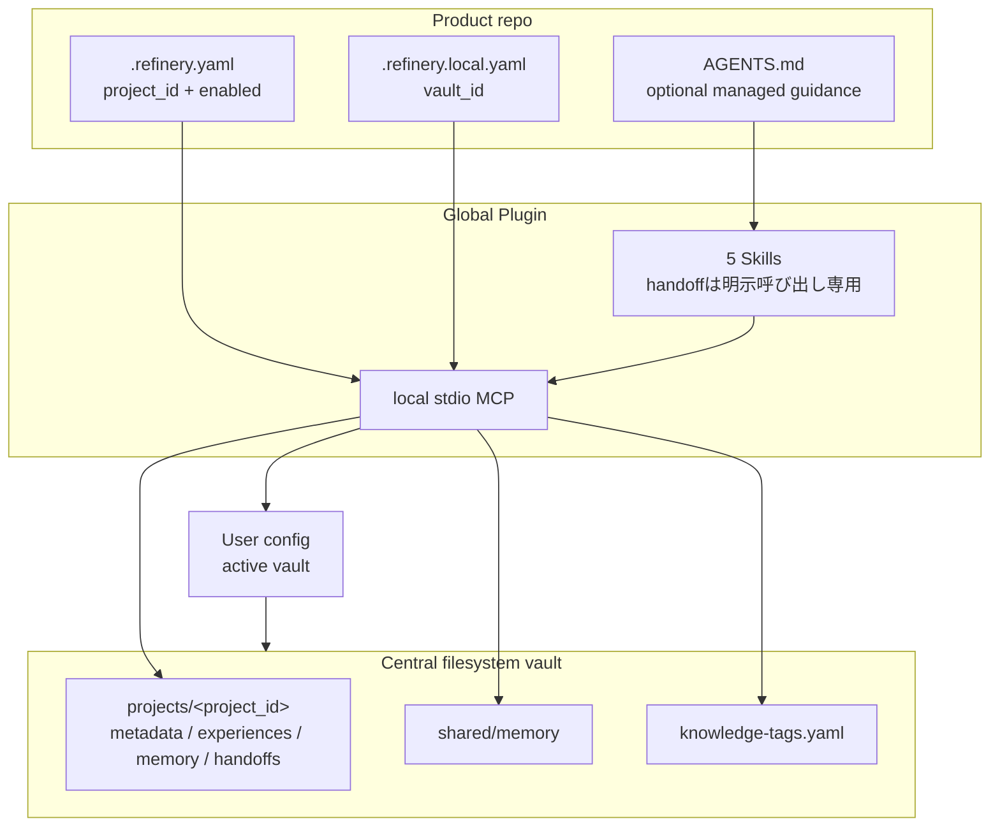

# アーキテクチャ

Knowledge Refineryは、利用repo、グローバルPlugin、ローカルMCP、中央vaultを分離します。
プロダクトのsourceとknowledgeの履歴を混ぜず、repo側には接続情報だけを置きます。

| 要素 | Source of truth | 役割 |
|---|---|---|
| 利用repo | `.refinery.yaml` | project IDと有効状態を共有する |
| ローカルbinding | `.refinery.local.yaml` | repoと個人のvault IDを結び付ける |
| Plugin | SkillsとMCP設定 | Codexの手順とtool interfaceを提供する |
| ユーザー設定 | active vaultのpath | 接続先を選ぶ |
| 中央vault | project/shared knowledge | ナレッジの実体を保存する |

## 境界

- PluginとMCPはユーザー単位でグローバルに1つ導入します。
- active vaultはユーザー設定に1つ持ちます。設定ファイルは `REFINERY_CONFIG` で明示でき、未指定時は `${XDG_CONFIG_HOME:-$HOME/.config}/knowledge-refinery/config.yaml` を使います。`REFINERY_VAULT` でactive vaultを一時overrideできます。
- repo-scoped MCP toolsは`project_path`を受け、server側で`enabled`、project metadata、repoと
  active vaultの`vault_id`一致を検証します。
- symlinkは人間の閲覧用であり、MCPとCLIの必須依存ではありません。
- vault markerのmanagerとschemaを利用前に検証し、未対応schemaへの書き込みを拒否します。
- 中央vaultの書き込みはatomic replaceとpath lockで破損を防ぎ、project metadata、experience、memory、tag taxonomyの更新は`expected_updated_at`による楽観的排他で競合上書きを拒否します。
- 検索は不正文書を隔離し、exact getは対象IDの正規pathを直接検証します。不正文書の一覧は `refinery_validate` が返します。
- `handoff_ops.py`は引き継ぎのsnapshotとライフタイムを管理します。通常検索に含めず、
  CLI／MCPの専用操作で取得します。詳細は[引き継ぎガイド](handoffs.md)にあります。

## データフロー

1. Skillが `project status` でrepoの有効性を確認する。
2. MCPが `project_path` からproject IDを導出する。
3. domain処理がproject metadataまたはknowledge文書のYAML schemaとprovenanceを検証する。
4. storage層が中央vaultへatomicに保存する。
5. Git履歴を有効にしたvaultでは、vault Gitがknowledge履歴をproduct Gitとは別に追跡する。

## issue管理

issueはprojectに所有させず、active vault直下の`issues.json`へ独立して保存します。
`projects`には登録済みproject IDを複数紐付けられ、空のままでも作成できます。
`tags`はissue専用の自由な分類で、既存の`knowledge-tags.yaml`とは独立しています。
通常のexperience／memory検索や`refinery_validate`の対象には含めません。
issueコマンドは保存データのschema・ID重複・履歴を読み込み時に検証します。

`issue_ops.py`がドメイン処理と永続化を所有し、`issue_cli.py`がCLIの入力・出力を担当します。
今回はローカルCLIのみで提供し、MCP toolsやリモート通信は追加しません。
ローカルrepoのパスや設定を必要とせず、project IDで紐付けるvault単位の操作です。
そのためrepoの`enabled`はissueの閲覧・更新権限を表しません。

保存形式は`schema_version: 1`と`issues`配列を持つJSONです。既存vaultは移行不要で、
最初の作成時にファイルを生成します。全書き込みを同じプロセス間lockで直列化し、
全体をatomic replaceすることでタグの一括変更も一度に確定します。
各issueは更新ごとに`revision`を増やし、時刻・理由・変更後のfield値を履歴に残します。
古いrevisionによる更新は拒否し、内容が変わらない更新ではrevisionを増やしません。

初期実装はファイル全体を読み書きする小規模なローカル運用向けです。
大量のissueや長い履歴を扱う場合のデータベース化は別途検討します。
