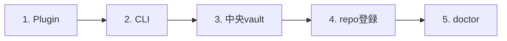

# インストールと初期設定

このページでは、Knowledge Refineryを使える状態までを順番にセットアップします。
完了すると、任意のrepoから中央vaultを検索し、experienceとmemoryを記録できます。

## 事前準備

| 必要なもの | 用途 |
|---|---|
| Codex、ChatGPT desktop app または Claude Code | PluginとSkillsを利用する |
| Python 3.11以上 | CLIとローカルMCPを実行する |
| `uv` | CLIのインストールとMCPの起動に使う |
| knowledge保存用directory | 複数repoのknowledgeを集約する |

セットアップは次の順序で進めます。



## 1. Pluginを追加

### Claude Code

```bash
claude plugin marketplace add skanehira1126/knowledge-refinery
claude plugin install knowledge-refinery@knowledge-refinery
```

ローカル checkout から導入する場合は GitHub 名の代わりに checkout の絶対パスを指定します。
新しいセッションで `/knowledge-refinery:refinery-project` を呼び出すと、
同梱 CLI で vault と対象 repo を設定できます。既存の有効な repo は同じ vault を引き続き使えます。
Claude Code の Bash 内で使う CLI は同梱されています。通常の端末からも使う場合は手順 2 で導入してください。

### Codex

=== "GitHub"

    ```bash
    codex plugin marketplace add skanehira1126/knowledge-refinery
    ```

=== "ローカルcheckout"

    ```bash
    PLUGIN_ROOT="$(pwd -P)"  # knowledge-refinery checkoutのrootで実行
    codex plugin marketplace add "$PLUGIN_ROOT"
    ```

Codex CLIの `/plugins`、IDEのPlugin settings、またはdesktop appのPlugin directoryで `knowledge-refinery` をinstallします。install後は新しいtask/sessionを開いてください。

## 2. CLIを追加

Skillがproject lifecycleを常に同じ手順で操作できるよう、CLIをPATHへinstallします。

=== "GitHub"

    ```bash
    uv tool install git+https://github.com/skanehira1126/knowledge-refinery.git
    ```

=== "開発checkout"

    ```bash
    PLUGIN_ROOT="$(pwd -P)"  # knowledge-refinery checkoutのrootで実行
    uv tool install --editable "$PLUGIN_ROOT"
    ```

## 3. 中央vaultを初期化

```bash
REFINERY_VAULT="${HOME}/knowledge-refinery-vault"  # 任意の保存先へ変更可能
knowledge-refinery vault init --root "$REFINERY_VAULT"

# Git履歴を残す場合に明示実行
git -C "$REFINERY_VAULT" init
```

`vault init` はfilesystem上にvault markerと必要なディレクトリを作成し、そのvaultを
ローカルMCPのactive vaultにします。Git repositoryの初期化、commit、push、backupは
自動実行しません。Git履歴が必要な場合だけ、上の`git init`も実行します。vaultをObsidianで
開いたときのローカル設定をknowledge履歴へ混ぜないよう、`/.obsidian/`は`.gitignore`へ
自動追加します。既存のignore設定は保持します。

既存vaultへ切り替えるときは次を使います。active vaultはユーザー全体で1つのため、
切り替えると他repoや別taskのMCP検索先も変わります。

```bash
knowledge-refinery vault configure --root "$REFINERY_VAULT"
```

## 4. repoを登録

通常はproject IDと表示名をrepository directory名から自動設定できます。

```bash
PROJECT_ROOT="$(git rev-parse --show-toplevel)"  # 導入対象repoで実行
knowledge-refinery project setup \
  --target "$PROJECT_ROOT" \
  --vault "$REFINERY_VAULT"
```

登録後は、Pluginの固定hookが新しいセッションの開始時と圧縮後に運用指示を渡します。
Codexでは、CLIの `/hooks` またはデスクトップアプリの `Settings → Hooks` で使うhookを信頼してください。通常の作業中に設計・調査・比較の
判断に役立つときだけ検索し、再利用できる経験や根拠の揃ったproject memoryを保存・確認します。

project IDはrepository directory名を小文字、数字、hyphenのslugにして生成され、登録後は
変更されません。表示名もdirectory名が初期値です。別の値を指定する必要がある場合だけ、
`--project-id`と`--project-name`を使います。概要、検索用tag、利用技術もsetup時または後から
metadataへ追加できます。

```bash
knowledge-refinery project setup \
  --target "$PROJECT_ROOT" \
  --vault "$REFINERY_VAULT" \
  --project-id my-project \
  --project-name "My Project" \
  --summary "プロジェクトの目的を一文で記述" \
  --tag backend \
  --technology Python
```

project IDを自動生成できないdirectory名や、vault内の既存IDと重複する場合は、
`--project-id`で一意なslugを指定します。このコマンドは
`.refinery.yaml`と中央vaultのproject領域、`project.yaml`を整備し、`--vault`で指定した
vaultをactive vaultへ設定します。project metadataには名前、概要、検索用tag、利用技術が入り、
cross-project検索の範囲判断に使われます。vault markerとgitignore済みの
`.refinery.local.yaml`には同じ不変`vault_id`が保存され、version管理可能な`.refinery.yaml`へ
個人のvault identityを混ぜずに誤接続を拒否します。`--agents`を省略した場合は
`AGENTS.md`を作成・変更しません。

自動生成されたproject IDも不変です。設定済みrepoでsetupを再実行し、明示した名前、概要、
tag、technologyが現在値と異なる場合は、
指定値を黙って無視せずエラーになります。案内に従って、現在revisionを取得してから
`project metadata update`を使います。

共通指示をファイルにも置く場合だけ`--agents`を付けます。以前の導入で追加したmanaged blockも
引き続き読み込まれます。固定hookと配信内容が重なる場合は、使いたい経路を選べます。
Codexで固定hookだけを止める手順と、個別にSkillを呼ぶ依頼例は[エージェントへの頼み方](agent-workflow.md)にあります。
repoのガイドにも固有のルールを記載する場合は[AGENTS.md追記サンプル](agents-guidance-examples.md)を参照してください。

```text
$refinery-projectを使って、このrepoをKnowledge Refineryへ登録してください。
project IDの候補はdirectory名から作り、IDとactive vaultの切り替えを私が確認してからsetupしてください。
AGENTS.mdは変更しないでください。
```

## 5. 検証

```bash
knowledge-refinery project status --target "$PROJECT_ROOT" --json
knowledge-refinery doctor --target "$PROJECT_ROOT"
```

`doctor`の`ok: yes`を確認します。doctorはvault schema、書き込み可能性、knowledge文書、
ローカルMCP runtime、project登録を検査します。意図的にdisabledにしたrepoはhealthy opt-outとして
扱われ、repo-scoped toolsは利用できないことが`project.state`に表示されます。Codex側のPlugin
登録確認はPlugin settingsで行います。

MCP接続後は `refinery_info` の `version` を `MCP_VERSION` に設定し、doctorへ渡して一致を確認します。

```bash
knowledge-refinery doctor --target "$PROJECT_ROOT" --mcp-version "$MCP_VERSION"
```

一致しない場合はPluginとCLIの片方だけが更新されています。両方を同じreleaseへ揃えてから書き込みを開始します。

!!! success "セットアップ完了"
    `doctor`が`ok: yes`を返し、Plugin settingsに`knowledge-refinery`が表示されていれば準備完了です。
    次に[最初のtask](#6-task)を開始します。

## 6. 最初のtask

新しいtaskを開いて通常の開発を依頼できます。読み取りだけを依頼する場合は、その範囲を伝えます。

```text
Knowledge Refineryから今回の判断に関係するmemoryとexperienceを検索してください。
今回はvaultへ書き込まないでください。
```

Experienceやmemoryへはsecret、credential、token、個人情報、顧客データを保存しません。
logやerror messageは機密値を除去します。CLIとMCPはvault Gitを自動commitしないため、
記録後はvaultの差分を確認し、product repoとは別のcommitにします。
